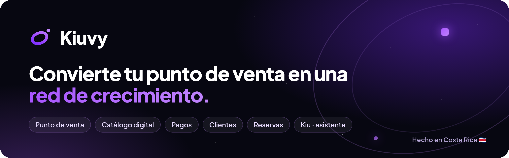

  

  <b>Conectamos negocios y clientes en un ecosistema digital moderno, simple y poderoso.</b>

  
  
  
  

---

### ✦ Qué hacemos

Kiuvy es el ecosistema de punto de venta para negocios de Costa Rica y Latinoamérica. Cada venta no termina en la caja: se convierte en una relación que hace crecer el negocio.

| | |
|:--|:--|
| 🛒 **Punto de venta** | Cobra rápido en mostrador, celular o tablet. Productos, inventario y cierres del día claros. |
| 📲 **Catálogo digital** | Tu menú, tienda o servicios listos para compartir por QR, enlace, WhatsApp o Instagram. |
| 💳 **Pagos** | SINPE Móvil, tarjeta, efectivo o QR: cada cobro queda registrado en un solo lugar. |
| 🧾 **Facturación electrónica** | Comprobantes pensados para Hacienda 4.4, sin salir de tu operación diaria. |
| 🤝 **Clientes y fidelización** | Recibos digitales, historial y beneficios con **Kiuvy Stars** para que cada cliente vuelva. |
| 📅 **Kiuvy Services** | Reservas y citas para salones, barberías, clínicas y negocios de servicios. |
| ✨ **Kiu, tu asistente** | Atiende, responde y comparte tu catálogo por WhatsApp, incluso cuando estás ocupado. |

### ✦ Para quién

Restaurantes · Sodas y cafés · Tiendas y boutiques · Minisúpers · Salones y barberías · Servicios · Emprendimientos

### ✦ Respaldos

Kiuvy forma parte de **NVIDIA Inception**, el programa de NVIDIA para startups que construyen con inteligencia artificial.

### ✦ Hablemos

- 🌐 **Sitio:** [kiuvy.com](https://kiuvy.com)
- ✉️ **Correo:** [info@kiuvy.com](mailto:info@kiuvy.com)
- 🔐 **Seguridad:** ¿encontraste una vulnerabilidad? Sigue nuestra [política de divulgación responsable](https://kiuvy.com/seguridad#divulgacion).
- 📣 **Síguenos:** [LinkedIn](https://www.linkedin.com/company/kiuvy) · [Instagram](https://www.instagram.com/kiuvy_universe) · [Facebook](https://www.facebook.com/profile.php?id=61590416262850) · [YouTube](https://www.youtube.com/@Kiuvy-cosmic)

🌎 <b>English:</b> Kiuvy is a Costa Rican company building a point-of-sale ecosystem (POS, digital catalog, payments, e-invoicing, bookings and a WhatsApp assistant) that turns every sale into a lasting customer relationship.

---

  <b>Kiuvy S.A.</b> · Naranjo, Alajuela, Costa Rica 🇨🇷 · Diseñado para crecer contigo · Enfoca · Conecta · Crece

